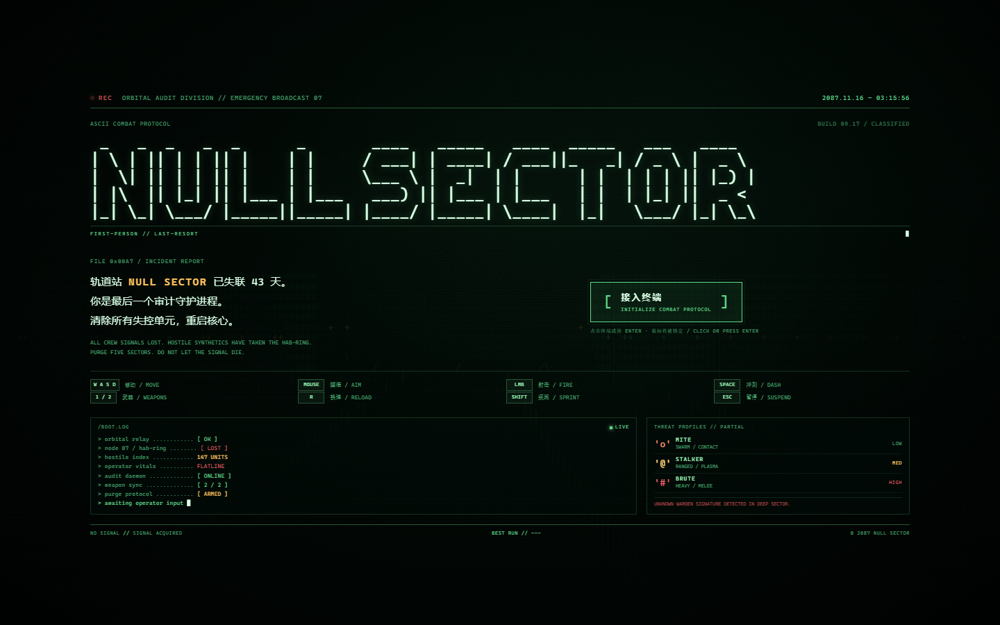
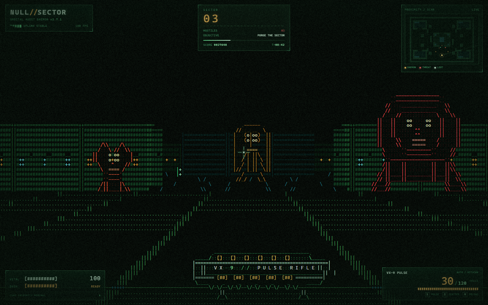
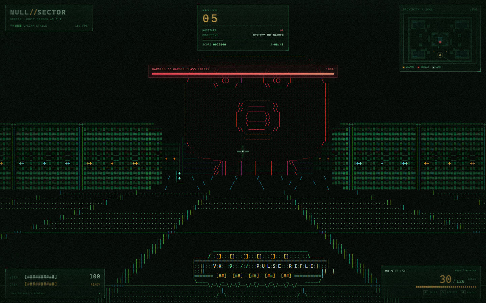

# NULL SECTOR // ASCII FPS

> 2087 年，轨道站 **NULL SECTOR** 已失联 43 天。你是最后一个审计守护进程。  
> 穿过字符构成的舱室，清除失控合成体，重启核心。

一个完全运行在浏览器里的 **ASCII 风格第一人称射击游戏**。纯前端、零依赖、无外部图片/音频素材。

---

## 快速开始

### 方式 A：直接打开（最快）

双击 **index.html**，或用 Chrome / Edge / Firefox 打开它。

### 方式 B：本地服务器（推荐，鼠标锁定更稳）

在本目录执行：

    python -m http.server 8000

然后访问 http://localhost:8000 。

点击画面中的 **“接入终端 / INITIALIZE”**。浏览器会请求锁定鼠标；允许后即可开始。

---

## 操作

| 输入 | 动作 |
|---|---|
| **W A S D** | 移动 |
| **鼠标** | 瞄准（需要鼠标锁定） |
| **左键** | 射击 |
| **空格** | 冲刺 / 短暂无敌帧 |
| **Shift** | 疾跑 |
| **1 / 2 / Q / 滚轮** | 切换 **VX-9 脉冲步枪** / **SCATTER-12 霰弹枪** |
| **R** | 换弹 |
| **M** | 静音 / 恢复音频 |
| **F** | 全屏 |
| **Esc** | 暂停 / 恢复 |

### 鼠标锁定失败？

有些嵌入式预览、无头浏览器或权限设置会拒绝 Pointer Lock。此时游戏仍然能玩：

- 用 **← →** 转向，**↑ ↓** 轻微抬头/低头；
- 用 **右键拖动** 观察；
- 其他操作不变。

HUD 底部会出现 **LOCK OFFLINE** 提示。真实 Chrome/Edge 桌面窗口中一般可正常锁定鼠标。

---

## 游戏内容

- **5 个扇区 / 5 波敌人**，从侦查蜂群一路打到会蓄力齐射、召唤护卫的最终 Boss **WARDEN**。
- **三类普通敌人**
  - **MITE**：高速近战蜂群；
  - **STALKER**：保持距离、发射等离子弹幕；
  - **BRUTE**：高血量、重击近战。
- **两把武器**
  - **VX-9 PULSE**：自动、精准、弹匣 30；
  - **SCATTER-12**：近距离扇形弹丸，对 Boss 和 Brute 有爆发伤害。
- **补给与掉落**：生命包、脉冲电池、霰弹；清理扇区会投放补给箱。
- **应急电池制造**：所有弹药耗尽时，终端会缓慢合成应急脉冲电池，确保不会彻底卡死。
- **战术扫描雷达**：显示地图结构、敌人、掉落物与传送信号。
- **本地最高分**：通过浏览器 localStorage 记录最佳扇区与分数。
- 程序化音效、CRT 扫描线/噪点/暗角、受到攻击时的终端故障效果。

---

## 视觉与技术

- 使用 **Canvas + 等宽字符** 逐帧绘制 ASCII 帧缓冲，而不是贴图或 DOM 字符。
- **DDA 光线投射** 渲染墙体、地板、天花，带纹理和距离雾。
- z-buffer 处理 **ASCII Billboard 敌人**，轮廓使用泛洪填充生成更实心的剪影。
- 所有声音由 **Web Audio API** 实时合成（激光、霰弹、受伤、警报、环境底噪等）。
- 无外部依赖、无网络请求；index.html、style.css、game.js 即可运行。

### 文件结构

    ASCII_FPS/
    ├─ index.html          # 标题、HUD、暂停/结束界面
    ├─ style.css           # CRT 终端主题与响应式 HUD
    ├─ game.js             # 地图、光线投射、AI、武器、音频、流程
    ├─ README.md
    ├─ play.bat            # Windows 一键打开
    └─ screenshots/
       ├─ title.png
       ├─ gameplay.png
       └─ warden.png

### 提示

- 推荐桌面端 16:9 / 16:10 全屏体验；触屏设备会提示横屏，但目前没有触控射击操作。
- 如果觉得画面太暗：这是刻意做旧终端风格；显示器亮度调高一点，红色敌人轮廓会更明显。
- 游戏有调试接口：打开控制台可访问 **window.NULLSECTOR**，例如 **NULLSECTOR.start(5)** 直达最终扇区。

---

**BUILD 09.17 / ORBITAL AUDIT DIVISION**  
*FIRST-PERSON // LAST-RESORT*
